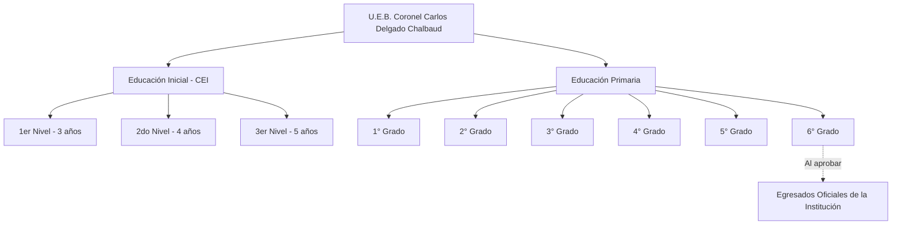
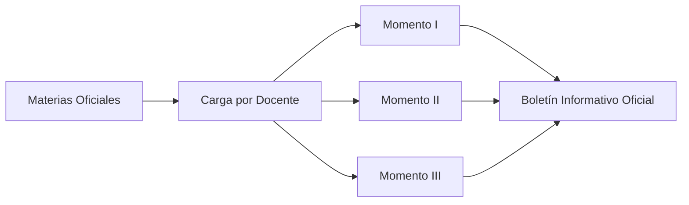
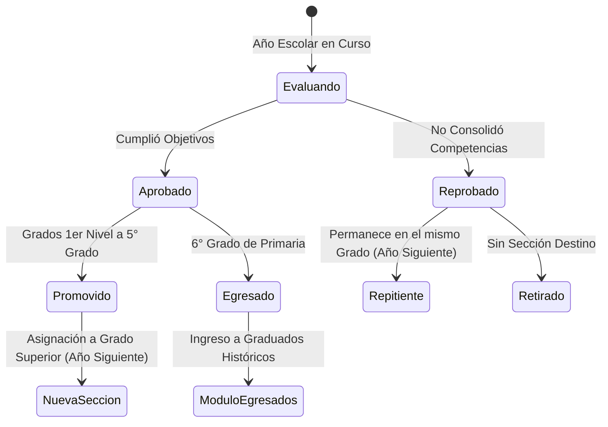
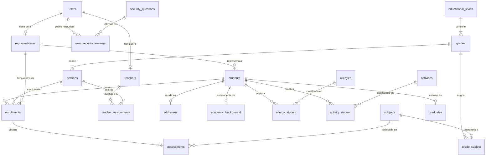

# GestiChalbaud

> **Plataforma Integral de Administración y Automatización Académica**  
> Diseñada para la **Unidad Educativa Bolivariana "Coronel Carlos Delgado Chalbaud"**.

[](https://laravel.com)
[](https://php.net)
[](https://mysql.com)
[](https://tailwindcss.com)
[](https://vitejs.dev)
[](#-arquitectura-del-sistema)

---

## 📖 Tabla de Contenidos

1. [Visión General y Propósito Didáctico](#-visión-general-y-propósito-didáctico)
2. [Arquitectura del Sistema y Stack Tecnológico](#-arquitectura-del-sistema-y-stack-tecnológico)
3. [Estructura y Niveles Educativos](#-estructura-y-niveles-educativos)
4. [Control de Acceso y Roles (RBAC)](#-control-de-acceso-y-roles-rbac)
5. [Módulos Funcionales Detallados](#-módulos-funcionales-detallados)
   - [1. Seguridad, Autenticación y Recuperación](#1-seguridad-autenticación-y-recuperación)
   - [2. Matrícula y Wizard de Inscripción (6 Pasos)](#2-matrícula-y-wizard-de-inscripción-6-pasos)
   - [3. Gestión de Aulas y Asignaciones Docentes](#3-gestión-de-aulas-y-asignaciones-docentes)
   - [4. Calificaciones Cualitativas y Boletines Informativos](#4-calificaciones-cualitativas-y-boletines-informativos)
   - [5. Promoción Estudiantil y Cierre de Ciclo](#5-promoción-estudiantil-y-cierre-de-ciclo)
   - [6. Repositorio Histórico de Egresados](#6-repositorio-histórico-de-egresados)
   - [7. Portal del Representante](#7-portal-del-representante)
   - [8. Catálogos y Geolocalización Oficial](#8-catálogos-y-geolocalización-oficial)
6. [Flujos de Trabajo del Sistema (Explicación Didáctica)](#-flujos-de-trabajo-del-sistema-explicación-didáctica)
7. [Modelo y Normalización de Base de Datos (DER)](#-modelo-y-normalización-de-base-de-datos-der)
8. [Instalación y Configuración Local](#-instalación-y-configuración-local)
9. [Cuentas y Credenciales de Prueba](#-cuentas-y-credenciales-de-prueba)
10. [Estructura de Directorios](#-estructura-de-directorios)
11. [Mantenimiento y Solución de Problemas](#-mantenimiento-y-solución-de-problemas)

---

## 🎯 Visión General y Propósito Didáctico

**GestiChalbaud** nace para sustituir los antiguos expedientes en carpetas físicas y las hojas de cálculo dispersas por un **ecosistema digital centralizado, seguro y auditable**, adaptado fielmente al modelo curricular y normativo del **Ministerio del Poder Popular para la Educación (MPPE)** de Venezuela.

### ¿Qué problemas resuelve el sistema?

* 🗂️ **Pérdida de expedientes:** Centraliza el historial biopsicosocial, médico, académico y familiar de cada alumno.
* ⏳ **Colas y lentitud en inscripciones:** Introduce un formulario por pasos (*Wizard Multi-step*) asistido por catálogos inteligentes de geografía venezolana, alergias y actividades extracurriculares.
* 🔒 **Seguridad y privacidad:** Aislamiento estricto de funciones mediante Roles (RBAC). Los docentes solo pueden visualizar e interactuar con los estudiantes de sus aulas asignadas en el año lectivo activo.
* 📊 **Evaluación por Momentos (Lapsos):** Registro matricial de calificaciones cualitativas (`A`, `B`, `C`, `D`, `E`) con observaciones y generación automática de boletines listos para impresión física o PDF.
* 🎓 **Trazabilidad de Fin de Curso:** Determina automáticamente qué estudiantes son promovidos, repitientes o egresados al culminar el 6° grado escolar.

---

## 🏗️ Arquitectura del Sistema y Stack Tecnológico

El proyecto está edificado bajo una arquitectura sólida orientada a la mantenibilidad y desacoplamiento de responsabilidades:

```
┌────────────────────────────────────────────────────────────────────────┐
│                        FRONTEND (UI / UX)                              │
│  Blade Templates + Tailwind CSS + Alpine.js / Vanilla JS (No Bundler)   │
└───────────────────────────────────┬────────────────────────────────────┘
                                    │ Peticiones HTTP / Form POST / AJAX
                                    ▼
┌────────────────────────────────────────────────────────────────────────┐
│                      CAPA DE ENRUTAMIENTO Y RBAC                       │
│      Middlewares: auth, guest, throttle:5,1, Role Checks               │
└───────────────────────────────────┬────────────────────────────────────┘
                                    │
                                    ▼
┌────────────────────────────────────────────────────────────────────────┐
│                       CONTROLADORES (Thin Controllers)                 │
│  StudentController, SectionController, TeacherController, etc.        │
└───────────────────────────────────┬────────────────────────────────────┘
                                    │ Delega lógica compleja
                                    ▼
┌────────────────────────────────────────────────────────────────────────┐
│                       CAPA DE SERVICIOS (Services Layer)               │
│  • StudentRegistrationService (Transacciones atómicas DB::transaction)  │
│  • CaptchaService (Renderizado dinámico GD en memoria sin terceros)    │
└───────────────────────────────────┬────────────────────────────────────┘
                                    │ Consultas / Mutaciones Eloquent ORM
                                    ▼
┌────────────────────────────────────────────────────────────────────────┐
│                  BASE DE DATOS RELACIONAL (MySQL 8.0+)                 │
│       Esquema 3FN (users, students, representatives, enrollments)      │
└────────────────────────────────────────────────────────────────────────┘
```

### Componentes Tecnológicos Clave

| Componente | Tecnología | Rol en el Sistema |
| :--- | :--- | :--- |
| **Backend Core** | PHP 8.2+ / Laravel 12.x | Núcleo del servidor, motor de plantillas Blade, autenticación y transacciones. |
| **Base de Datos** | MySQL 8.0+ | Motor relacional con integridad referencial, llaves foráneas e índices optimizados. |
| **Estilos y Diseño** | Tailwind CSS (v3 / v4) | Sistema de diseño atómico con paleta institucional y modo responsivo para tabletas y escritorios. |
| **Interactividad** | JavaScript Vanilla + Alpine.js | Menú móvil, navegación entre pasos del wizard, listas geográficas en cascada y modales. |
| **Motor Gráfico GD** | Extensión PHP `gd` | Renderizado nativo del Captcha anti-bots in-memory (no requiere conexión a servidores de Google). |
| **Tipografía** | Inter & Plus Jakarta Sans | Fuentes modernas de alta legibilidad para interfaces administrativas y boletines. |

---

## 🏫 Estructura y Niveles Educativos

GestiChalbaud modela la estructura educativa oficial venezolana en dos grandes niveles escolares:



### Características de las Aulas (Secciones)

* **Sección Dinámica:** El Administrador puede crear tantas secciones como demande la matrícula (`"A"`, `"B"`, `"C"`, `"D"`...).
* **Turnos de Operación:** Soporta turnos de tipo **Mañana**, **Tarde** e **Integral**.
* **Capacidad y Año Lectivo:** Las secciones se vinculan con los años escolares (ej. `2024-2025`), preservando el histórico de qué alumnos estuvieron en qué sección en cada año escolar.

---

## 🛡️ Control de Acceso y Roles (RBAC)

El acceso al sistema está restringido según el rol asignado a la cuenta del usuario:

| Módulo / Acción | Administrador (`admin` / `worker`) | Docente (`docente`) | Representante (`representative`) |
| :--- | :---: | :---: | :---: |
| **Gestionar Años Escolares** | ✅ Total | ❌ Sin acceso | ❌ Sin acceso |
| **Crear y Editar Aulas** | ✅ Total | ❌ Sin acceso | ❌ Sin acceso |
| **Asignar Docentes a Secciones** | ✅ Total | ❌ Sin acceso | ❌ Sin acceso |
| **Inscribir Estudiantes (Wizard Completo)** | ✅ Sí (cualquier aula) | ❌ Sin acceso | ✅ Sí (solo sus representados, queda pendiente de aula) |
| **Cargar Calificaciones (Notas A-E)** | ✅ Permitido | ✅ Solo en su aula asignada | ❌ Solo lectura |
| **Ejecutar Promoción de Fin de Ciclo** | ✅ Sí | ❌ Sin acceso | ❌ Sin acceso |
| **Consultar Boletín Informativo** | ✅ Todos | ✅ Estudiantes de su aula | ✅ Solo de sus representados |
| **Ver Módulo de Egresados** | ✅ Completo | ✅ Solo lectura | ❌ Sin acceso |
| **Gestionar Usuarios del Sistema** | ✅ Total | ❌ Sin acceso | ❌ Sin acceso |
| **Actualizar Ficha Médica y Contacto** | ✅ Total | ❌ Sin acceso | ✅ De sus hijos/representados |

---

## 🧩 Módulos Funcionales Detallados

### 1. Seguridad, Autenticación y Recuperación

```
             ┌────────────────────────────────────────────────────────┐
             │               Pantalla de Inicio de Sesión             │
             │   [ Cédula de Identidad ]  [ Contraseña Secreta ]      │
             │           [ Captcha Gráfico In-Memory ]                │
             └───────────────────────────┬────────────────────────────┘
                                         │ Credenciales correctas
                                         ▼
                     ┌───────────────────────────────────────┐
                     │  Verificación de Estado 'is_active'   │
                     └───────────────────┬───────────────────┘
                                         │ Usuario Activo
                                         ▼
                 ┌───────────────────────────────────────────────┐
                 │       Redirección al Dashboard por Rol        │
                 └───────────────────────────────────────────────┘
```

* **Identificador Universal:** Se utiliza el número de **Cédula de Identidad** (tipo numérico) en lugar de un nombre de usuario genérico o correo electrónico.
* **Captcha In-House en Memoria (`CaptchaService`):**
  * Genera una imagen aleatoria de 5 caracteres alfanuméricos (`ABCDEFGHJKLMNPQRSTUVWXYZ23456789`).
  * Sin dependencia de servicios externos de terceros (no se bloquea por falta de internet o restricciones de firewall).
  * Devuelve una respuesta HTTP nativa con encabezados `no-cache`, permitiendo su correcto funcionamiento detrás de proxies reversos y túneles (ej. Ngrok, Cloudflare).
* **Recuperación Dinámica por Preguntas de Seguridad:**
  * Si un usuario olvida su contraseña, ingresa su Cédula.
  * El sistema consulta vía AJAX la pregunta previamente seleccionada por el usuario (ej. *"¿Cuál es el nombre de tu primera mascota?"*).
  * El usuario responde; si la respuesta coincide con el hash almacenado, se habilita el formulario para restablecer la contraseña.
  * Protegido contra fuerza bruta con **Rate Limiting** de 5 intentos por minuto (`throttle:5,1`).

---

### 2. Matrícula y Wizard de Inscripción (6 Pasos)

El formulario de inscripción está diseñado como un **asistente por etapas (Wizard)** que reduce la fatiga visual y guía al usuario paso a paso:

```
[ 1. Identidad ] ──> [ 2. Salud ] ──> [ 3. Ubicación ] ──> [ 4. Académico ] ──> [ 5. Entorno ] ──> [ 6. Asignación ]
```

#### Paso 1: Identificación del Estudiante
* Primer nombre, segundo nombre, primer apellido, segundo apellido.
* Cédula de identidad (opcional para infantes sin cédula emitida).
* Fecha de nacimiento con cálculo dinámico de edad (regla estándar: entre **3 y 17 años**).
* Género (`M` / `F`).
* Estado y localidad de nacimiento.

#### Paso 2: Antropometría y Salud
* **Tallas de Indumentaria:** Camisa (tallas 2 a XXL), Pantalón y Calzado (tallas 18 a 42).
* **Medidas Físicas:** Peso en kilogramos (con decimales) y Estatura en metros.
* **Catálogo Multiselección de Alergias:** Desplegable clasificado en 5 categorías:
  1. *Medicamentos:* Penicilina, Amoxicilina, Aspirina, Ibuprofeno, etc.
  2. *Alimentos:* Maní, Mariscos, Pescado, Leche, Huevo, Gluten, etc.
  3. *Ambientales:* Polen, Ácaros, Pelo de animales, Moho.
  4. *Contacto:* Látex, Níquel.
  5. *Picaduras de Insectos:* Abeja, Avispa.
* Campo abierto para condiciones médicas especiales y alergias no catalogadas.

#### Paso 3: Ubicación Residencial (Geografía Dinámica en Cascada)
* Integrado a la división político-territorial oficial de Venezuela:
  * **Estado** ➡️ Desencadena la carga de los **Municipios** correspondientes por AJAX.
  * **Municipio** ➡️ Desencadena la carga de las **Parroquias** correspondientes.
* Sector, calle, número de casa o apartamento.

#### Paso 4: Antecedentes Académicos
* Nombre del plantel de procedencia.
* Código DEA del colegio anterior (para trámites de transferencia escolar).

#### Paso 5: Entorno Familiar y Actividades Recreativas
* ¿Con quién reside el estudiante? (Ambos padres, abuelos, tíos, tutor legal).
* Cantidad de hermanos en el núcleo familiar.
* **Catálogo de Intereses y Actividades Extracurriculares:** Organizado por pestañas interactivas:
  * *Deportes:* Fútbol, Béisbol, Baloncesto, Natación, Ajedrez, etc.
  * *Música:* Canto, Guitarra, Cuatro Llanero, Batería, Piano.
  * *Arte y Cultura:* Danza, Teatro, Dibujo y Pintura, Fotografía.
  * *Recreación y Ciencia:* Lectura, Robótica, Programación, Jardinería.

#### Paso 6: Asignación de Aula y Representante
* **Selección del Aula de Destino:** Grado, letra y turno escolar para el año lectivo en curso.
* **Selector Dinámico de Representante:** Buscador en vivo que permite vincular al estudiante con cualquier usuario previamente registrado en el sistema, o seleccionar un representante existente.

> [!TIP]
> **Modo Egresado Histórico:** El sistema cuenta con un interruptor especial que permite cargar estudiantes que ya culminaron su ciclo en años anteriores. Al activar este modo, se deshabilitan las restricciones de edad (máx. 17 años) y la asignación obligatoria de aula activa, almacenándolo directamente como graduado en el histórico institucional.

---

### 3. Gestión de Aulas y Asignaciones Docentes

* **Creación de Secciones:** Cada sección pertenece a un grado (`Educación Inicial` o `Educación Primaria`), tiene un nombre identificador (`A`, `B`, `C`...) y un turno escolar.
* **Asignación Exclusiva de Docentes:**
  * Cada aula puede tener un docente titular asignado para el año escolar en curso.
  * La base de datos garantiza mediante la tabla `teacher_assignments` que un docente no pueda tener aulas duplicadas en conflicto dentro del mismo ciclo lectivo.
* **Asignación Rápida de Estudiantes (`assignView`):**
  * Pantalla especial para incorporar masivamente a estudiantes activos que se encuentren registrados pero aún no posean aula en el año escolar vigente.

---

### 4. Calificaciones Cualitativas y Boletines Informativos

Bajo la normativa pedagógica de educación básica, la evaluación no es numérica tradicional de 0 a 20, sino formativa y cualitativa:



* **Escala de Calificación Oficial:**
  * **A:** Rendimiento Excepcional (alcanzó ampliamente todas las competencias).
  * **B:** Buen Rendimiento (alcanzó las competencias esperadas).
  * **C:** Rendimiento Aceptable (alcanzó la mayoría de las competencias mínimas).
  * **D:** Rendimiento en Proceso (requiere acompañamiento y refuerzo).
  * **E:** Rendimiento Insuficiente (no consolidó las competencias mínimas).
* **Observaciones Cualitativas:** Cada calificación permite acompañar un juicio valorativo y recomendaciones pedagógicas.
* **Boletín Informativo Automatizado:**
  * Vista imprimible con membrete institucional oficial de la U.E.B. Coronel Carlos Delgado Chalbaud.
  * Muestra el resumen de las tres etapas o momentos pedagógicos.
  * Incluye directivas de CSS `@media print` para ocultar la barra de navegación y generar un documento limpio en tamaño carta/oficio con un solo clic.

---

### 5. Promoción Estudiantil y Cierre de Ciclo

Al finalizar el año escolar, el Administrador ejecuta el proceso de **Cierre de Ciclo** desde la vista de sección:



1. **Estudiantes Promovidos (Niveles Iniciales y 1° a 5° Grado):**
   * Su estatus de matrícula en el año cursado cambia a `Promovido`.
   * Si se define un aula destino, se genera automáticamente su inscripción para el próximo año escolar (`next_school_year`).
2. **Estudiantes de 6° Grado (Culminación de Primaria):**
   * El sistema detecta automáticamente el rango del grado (`Rank = 26`).
   * El alumno pasa al estatus de `Egresado`.
   * Se crea un registro formal en la tabla `graduates` indicando el año escolar de egreso y su historial.
3. **Estudiantes Repitientes:**
   * Su estatus de matrícula se fija como `Repitiente` y se reasignan al mismo nivel educativo en el nuevo ciclo.

---

### 6. Repositorio Histórico de Egresados

Módulo especializado para el control institucional y auditoría de egresados:
* Filtro cronológico por **Año de Promoción** (ej. `2023-2024`, `2024-2025`).
* Búsqueda en tiempo real por nombre, apellido o número de cédula.
* Muestra el histórico del representante legal y notas pedagógicas de salida del plantel.

---

### 7. Portal del Representante

El sistema ofrece una experiencia de autoservicio para los padres y representantes:
* **Autoregistro Libre:** Formulario público en `/register-representative` donde el tutor ingresa sus datos personales, laborales, teléfono móvil, WhatsApp y define su pregunta de seguridad.
* **Mis Representados:** Listado de los hijos o menores a su cargo.
* **Pre-inscripción Online:** Los padres pueden registrar la ficha completa de su representado desde su hogar. Una vez guardado, el estudiante queda en estado de espera con una insignia en el panel del Administrador para su confirmación y asignación de sección.
* **Consulta de Desempeño Escolar:** Visualización de notas por lapso y descarga directa del boletín informativo sin necesidad de acudir a la secretaría del plantel.

---

### 8. Catálogos y Geolocalización Oficial

* **División Político-Territorial Oficial:** Tres tablas maestras (`estados`, `municipios`, `parroquias`) con la totalidad del territorio venezolano.
* **API Interna:** Endpoints JSON para consulta asíncrona:
  * `GET /api/locations/states`
  * `GET /api/locations/states/{id}/municipalities`
  * `GET /api/locations/municipalities/{id}/parishes`
* **Normalización de Direcciones:** La tabla `addresses` conserva tanto las claves foráneas de geolocalización como los campos de texto plano descriptivo para máxima resiliencia.

---

## 🔄 Flujos de Trabajo del Sistema (Explicación Didáctica)

### Flujo A: Configurar un Nuevo Año Escolar (Paso a Paso)

```
1. [Años Escolares] ──> Crear año (ej: 2024-2025) ──> Marcar como "Activo"
2. [Aulas]          ──> Crear Secciones (1° A, 1° B, etc.) asignando el turno
3. [Docentes]       ──> Registrar profesores y vincularlos a sus respectivas aulas
4. [Materias]       ──> Verificar las áreas curriculares asignadas a cada grado
```

### Flujo B: Inscribir y Matricular un Alumno (Vía Administrativa)

```
1. Ir a [Estudiantes] ──> Botón "Nueva Inscripción"
2. Completar los 6 pasos del Wizard (Datos personales, Tallas/Alergias, Dirección, Origen, Entorno)
3. En el Paso 6, buscar la cédula del representante registrado (o crearlo) y seleccionar el aula
4. Guardar: El sistema ejecuta una transacción atómica (DB::transaction) que crea al Estudiante,
   su Dirección, sus Alergias/Actividades asociadas y su Matrícula (Enrollment) activa.
```

### Flujo C: Carga de Notas y Emisión de Boletines (Vía Docente)

```
1. El docente ingresa con su Cédula y Contraseña.
2. Accede a "Mi Aula" (únicamente su aula asignada estará disponible).
3. Hace clic en "Calificaciones":
   - Selecciona la Materia y el Momento Pedagógico (I, II o III).
   - Ingresa las letras A, B, C, D o E junto a las observaciones de cada alumno.
   - Guarda los cambios.
4. Para emitir el boletín, entra a la ficha del estudiante y pulsa "Generar Boletín" -> Imprimir.
```

---

## 🗄️ Modelo y Normalización de Base de Datos (DER)

La arquitectura de datos de GestiChalbaud está diseñada bajo la **Tercera Forma Normal (3FN)**:
* La tabla `users` contiene la **identidad universal de personas** (nombres, apellidos, cédula, teléfono, credenciales).
* Las tablas de rol `representatives` y `teachers` contienen únicamente los atributos específicos de su función laboral o legal, con relación `1:1` hacia `users`.
* La tabla `students` concentra la ficha biopsicosocial del menor.
* La tabla `enrollments` es el **pivote histórico central**, garantizando que un estudiante pueda tener múltiples matrículas a lo largo de los años sin sobrescribir calificaciones anteriores.



---

## 💻 Instalación y Configuración Local

### Requisitos Previos
* **PHP:** Versión `8.2` o superior (con extensiones activas: `pdo_mysql`, `gd`, `mbstring`, `openssl`, `curl`, `fileinfo`).
* **Gestor de Paquetes:** [Composer](https://getcomposer.org/) (v2.x).
* **Base de Datos:** MySQL Server 8.0+ o MariaDB 10.4+.
* **Servidor Local:** [Laragon](https://laragon.org/) (Recomendado en Windows), XAMPP o Nginx.
* **Node.js & NPM:** Versión 18+ (opcional, para compilar estilos si se modifican plantillas).

---

### Paso a Paso para Despliegue en Windows (Laragon)

#### 1. Clonar o Ubicar el Proyecto
Ubica la carpeta del proyecto en el directorio raíz de tu servidor web (en Laragon suele ser `C:\laragon\www\GestiChalbaud`).

#### 2. Instalar Dependencias de PHP
Abre la terminal en la raíz del proyecto y ejecuta:
```bash
composer install
```

#### 3. Configurar el Archivo de Entorno (`.env`)
Si no existe el archivo `.env`, créalo copiando el archivo de ejemplo:
```bash
cp .env.example .env
```

Genera la llave criptográfica de la aplicación:
```bash
php artisan key:generate
```

Asegúrate de que los parámetros de base de datos en tu `.env` correspondan con tu servidor local:
```env
APP_NAME=GestiChalbaud
APP_ENV=local
APP_DEBUG=true
APP_URL=http://localhost:8000

DB_CONNECTION=mysql
DB_HOST=127.0.0.1
DB_PORT=3306
DB_DATABASE=gestichalbaud
DB_USERNAME=root
DB_PASSWORD=
```

#### 4. Crear la Base de Datos
En tu gestor de base de datos favorito (HeidiSQL, phpMyAdmin, DBeaver o la consola de MySQL), crea una base de datos vacía llamada `gestichalbaud`:
```sql
CREATE DATABASE IF NOT EXISTS gestichalbaud CHARACTER SET utf8mb4 COLLATE utf8mb4_unicode_ci;
```

#### 5. Ejecutar Migraciones y Cargar Catálogos Iniciales
Para crear todas las tablas, relaciones y datos esenciales (roles, niveles, materias oficiales, preguntas de seguridad, catálogo de alergias y catálogo de actividades):
```bash
php artisan migrate:fresh
php artisan db:seed
```

#### 6. (Opcional) Poblar con Datos de Prueba Completos
Para generar un entorno de demostración completo con **años escolares, 10 docentes, 50 estudiantes matriculados y sus representantes**:
```bash
php artisan db:seed --class=SystemTestDataSeeder
```

#### 7. Compilar Assets y Levantar el Servidor
Si vas a realizar modificaciones a las clases CSS utilitarias:
```bash
npm install
npm run build
```

Inicia el servidor de desarrollo de Laravel:
```bash
php artisan serve
```
El sistema estará accesible en tu navegador web en: `http://localhost:8000` (o a través del Virtual Host de Laragon en `http://gestichalbaud.test`).

---

## 🔑 Cuentas y Credenciales de Prueba

Al ejecutar los seeders del sistema, se crean cuentas preconfiguradas para explorar todos los roles:

### 1. Perfil Administrador Principal
* **Cédula de Identidad:** `12345678`
* **Contraseña:** `Admin123*`
* **Rol:** Administrador (`admin`)
* **Acceso:** Control total de configuraciones, matrículas, usuarios y promociones.

### 2. Perfil Docente Titular (Generado por Seeders)
* **Cédula de Identidad:** *(Consultar en la tabla `users` con rol `docente`)*
* **Contraseña Predeterminada:** El mismo número de cédula del docente.
* **Rol:** Docente (`docente`)
* **Acceso:** Carga de notas y gestión de su aula asignada.

### 3. Perfil Representante (Generado por Seeders / Autoregistro)
* **Cédula de Identidad:** *(Consultar en la tabla `users` con rol `representative`)*
* **Contraseña Predeterminada:** La definida en el registro o número de cédula.
* **Rol:** Representante (`representative`)
* **Acceso:** Portal familiar de seguimiento estudiantil.

---

## 📁 Estructura de Directorios

Resumen de la distribución de carpetas y código fuente principal:

```
GestiChalbaud/
├── app/
│   ├── Http/
│   │   ├── Controllers/
│   │   │   ├── Auth/                     # Autenticación, Captcha, Recuperación de clave
│   │   │   ├── Representative/           # Portal familiar (MyStudentsController)
│   │   │   ├── DashboardController.php   # Estadísticas y métricas por rol
│   │   │   ├── GraduateController.php    # Repositorio de egresados de 6to grado
│   │   │   ├── LocationController.php    # API de Estados, Municipios y Parroquias
│   │   │   ├── ReportController.php      # Generador de Boletín Informativo
│   │   │   ├── SectionController.php     # Aulas, asignación, notas y promociones
│   │   │   ├── StudentController.php     # CRUD de estudiantes e inscripciones
│   │   │   ├── TeacherController.php     # Nómina y asignación de docentes
│   │   │   └── UserController.php        # Gestión de cuentas y estados
│   │   └── Requests/                     # Reglas de validación desacopladas
│   ├── Models/                           # Entidades Eloquent (User, Student, Section, etc.)
│   └── Services/
│       ├── CaptchaService.php            # Generación y validación de Captcha en memoria
│       └── StudentRegistrationService.php# Lógica transaccional del Wizard de inscripción
├── config/                               # Configuraciones globales de Laravel
├── database/
│   ├── migrations/                       # 36 migraciones con el esquema relacional
│   └── seeders/                          # Pobladores de base de datos y catálogos
├── public/                               # Archivos públicos de entrada, logo y assets
├── resources/
│   └── views/
│       ├── auth/                         # Vistas de login, registro de representante y reset
│       ├── reports/                      # Plantilla del Boletín Informativo (boletin.blade.php)
│       ├── representative/               # Interfaz del portal de representantes
│       ├── sections/                     # Aulas, carga de notas y pantalla de promoción
│       ├── students/                     # Vistas del Wizard de inscripción y ficha del alumno
│       ├── dashboard.blade.php           # App Shell Layout principal con sidebar dinámico
│       └── welcome.blade.php             # Landing page institucional y login con Captcha
├── routes/
│   └── web.php                           # Definición de rutas, grupos y middlewares RBAC
└── tests/                                # Pruebas funcionales y unitarias
```

---

## 🛠️ Mantenimiento y Solución de Problemas

### 1. Limpieza de Caché y Optimización
Si realizas cambios en rutas, vistas o configuraciones que no se reflejan en pantalla:
```bash
php artisan optimize:clear
```

### 2. El Captcha no se muestra o da error de imagen
* Verifica que la extensión `gd` esté habilitada en tu archivo `php.ini` (busca `;extension=gd` y elimina el punto y coma `;`).
* Reinicia tu servidor web Apache/Nginx.

### 3. Error de conexión con MySQL (Error 2002 / Connection Refused)
* Comprueba que el servicio de MySQL esté iniciado en tu panel de control de Laragon o XAMPP.
* Si usas `localhost` en el `.env`, cámbialo por la dirección IP directa `127.0.0.1`.

### 4. Respaldo de Base de Datos
Para realizar una copia de seguridad rápida de la base de datos completa:
```bash
# En Windows (Laragon/MySQL CLI)
mysqldump -u root -p gestichalbaud > respaldo_gestichalbaud.sql
```

---

## 📄 Licencia y Reconocimientos

* **Institución:** Unidad Educativa Bolivariana "Coronel Carlos Delgado Chalbaud".
* **Desarrollo:** Sistema diseñado con altos estándares de arquitectura de software, normalización de datos e interfaz de usuario centrada en la accesibilidad.
* **Derechos:** Proyecto para uso administrativo y académico institucional.
